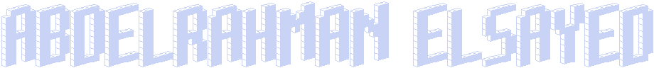

<p align="center">
  
</p>

# abdelrahmanelsayed20.github.io

Personal portfolio of **Abdelrahman Elsayed**, Data Science & AI at Zewail City University.
Live at **https://abdelrahmanelsayed20.github.io/**

Hand-built with plain HTML, CSS and JavaScript: no framework, no build step, no tracking.
Layout, motion and interaction patterns are inspired by [Fahd Seddik's portfolio](https://fahdseddik.github.io/).

## What's on it

Six pages, each with its own animated background, joined by a signature page transition:

| Page | Highlights |
| --- | --- |
| **Home** | "Text pressure" name (letters thin out near the cursor), interactive Rubik's cube, rotating quotes |
| **Education** | Live voxel lettering, pixel-dissolve separator, certification and coursework marquees |
| **Experience** | Scroll-pinned slideshow with a side rail, pixel-dissolve separator, a waffle chart of 100+ students |
| **Research** | fig. 01, the Optimizer Lab: Adam, SGD-M, RMSProp and AdaGrad racing down a 3D loss landscape, plus three studies |
| **Projects** | Featured carousel, filter pills, live BM25 search over the cards, case studies in native `<dialog>`s |
| **Skills** | Tech stack, a k-means playground and a playable Web Audio synth that names your chord |

Shared on every page: the transition (a panel slides up, the name writes itself in script, the next page arrives covered and the panel lifts away), a custom cursor, a WebGL dithered dot field that ripples under the pointer, dark and light themes, a generative ambient soundtrack, and full support for `prefers-reduced-motion`.

## Structure

```
index.html, education/, experience/, research/, projects/, skills/   one folder per page (index.html inside)
404.html                       custom not-found page
assets/css/site.css            the whole design system
assets/js/site.js              shared runtime: theme, nav, cursor, page transition, background, sound, dialogs
assets/js/home.js, cube.js     home: text-pressure name, Rubik's cube (three.js)
assets/js/voxel.js, retro.js   education/experience: voxel letters, pixel-dissolve separators
assets/js/lab.js               research: the Optimizer Lab (math core is unit-testable in Node)
assets/js/projects.js          projects: carousel, filters, BM25 search
assets/js/kmeans.js, piano.js  skills: k-means playground, synth
assets/img/                    name GIFs, separators, icons, social preview
assets/Abdelrahman-Elsayed-CV.pdf
_archive/                      the previous single-page version (not published: Jekyll skips "_" folders)
```

## Updating

- **CV:** replace `assets/Abdelrahman-Elsayed-CV.pdf` and keep the same file name.
- **Projects:** each card is an `<article class="pcard">` in `projects/index.html`. `data-cat` sets the filter pills and `data-search` adds search keywords. Case studies are the `<dialog class="cs">` elements at the end of the file; a button with `data-case="<id>"` opens `#cs-<id>`, and `/projects/#case-<id>` links straight to one.
- **Navigation, footer and head** are repeated in every page's HTML. If you rename a tab, change it in all seven files.
- **Social preview:** `assets/img/og-image.png` (1200 × 630) is what LinkedIn and WhatsApp show when the link is shared.

## Run locally

Pages use root-relative paths (`/assets/...`), so serve the folder instead of opening the files directly:

```bash
python -m http.server 8000
# then open http://localhost:8000
```

## Credits

- Design inspiration: [Fahd Seddik](https://github.com/FahdSeddik). The voxel name and terminal GIFs follow the style of the ones on his GitHub profile, redrawn with my name; `wave.gif` is from the same profile.
- Signature font: [Ms Madi](https://fonts.google.com/specimen/Ms+Madi), SIL Open Font License (`assets/fonts/OFL-MsMadi.txt`).
- Tech icons: [Devicon](https://devicon.dev/) (MIT). 3D cube: [three.js](https://threejs.org/).
